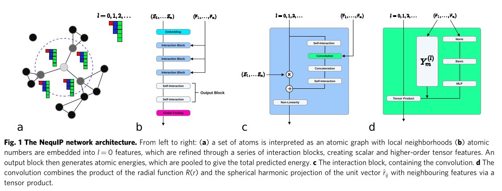

# LAMMPS CHEMTRAIN DEPLOY



**LAMMPS** stands for **L**arge-scale **A**tomic/**M**olecular **M**assively **P**arallel **S**imulator.

This is the **LAMMPS** software package with the chemtrain deploy package linked to the code.

The **MLIP models** from https://github.com/camml-lab/tensorial.git are supported by this **LAMMPS** version.


Copyright (2003) Sandia Corporation. Under the terms of Contract DE-AC04-94AL85000 with Sandia Corporation, the U.S. Government retains certain rights in this software. This software is distributed under the GNU General Public License.

**LAMMPS** is a classical molecular dynamics simulation code designed to run efficiently on parallel computers. It was developed at Sandia National Laboratories, a US Department of Energy facility, with funding from the DOE. It is an open-source code, distributed freely under the terms of the GNU Public License (GPL) version 2.

The code is maintained by the LAMMPS development team who can be emailed at developers@lammps.org.

The **LAMMPS** website at [www.lammps.org](https://www.lammps.org) has more information about the code and its uses.

## Distribution contents

The LAMMPS distribution includes the following files and directories:

| File / Directory | Description |
|---|---|
| `README.md` | this file |
| `LICENSE` | the GNU General Public License (GPLv2) |
| `CITATION.cff` | Citation information for LAMMPS in CFF format |
| `bench` | benchmark inputs |
| `cmake` | CMake build files |
| `doc` | documentation |
| `examples` | example inputs for many LAMMPS commands |
| `fortran` | Fortran 2003 module for LAMMPS |
| `lib` | additional provided or external libraries |
| `potentials` | interatomic potential files |
| `python` | Python module for LAMMPS |
| `src` | source files |
| `third_party` | Copies of thirdparty software bundled with LAMMPS |
| `tools` | pre- and post-processing tools |
| `unittest` | test programs for use with CTest |
| `.github` | Git and GitHub related files and tools |
| `chemtrain` | Chemtrain Git submodule|
| `tensorial` | Tensorial Git submodule|

## Documentation

Point your browser at any of these links to get started:

- [LAMMPS manual](https://docs.lammps.org/Manual.html)
- [Hi-level introduction](https://docs.lammps.org/Intro.html)
- [How to build LAMMPS](https://docs.lammps.org/Build.html)
- [How to run LAMMPS](https://docs.lammps.org/Run_head.html)
- [Table of available commands](https://docs.lammps.org/Commands_all.html)
- [Short tutorials and HowTo discussions](https://docs.lammps.org/Howto.html)
- [How to interpret and debug errors](https://docs.lammps.org/Errors.html)
- [LAMMPS library interfaces](https://docs.lammps.org/Library.html)
- [How to modify and extend LAMMPS](https://docs.lammps.org/Modify.html)
- [LAMMPS developer info](https://docs.lammps.org/Developer.html)

You can also create these doc pages locally:

```bash
cd doc
make html                # creates HTML pages in doc/html
make pdf                 # creates Manual.pdf
```

## Installation Instructions

#### Python venv initialisation

First install all required Python packages in your Python venv:

```bash
./setup_python_venv.bash <path_to_your_python_venv>
```


#### Chemtrain deploy connector compilation

The CPU connector is already stored next to the connector sources in `lammps-chemtrain/src/CHEMTRAIN-DEPLOY/lib`

As regards the GPU connector, because of its size, it must be built from sources.

Then manually copy the `lib` directory in `src/CHEMTRAIN-DEPLOY/` under the name `lib-cuda`

For the CPU connector output directory `lib` must be paste to `lammps-chemtrain/src/CHEMTRAIN-DEPLOY`


#### CPU Connector

Run `build.py` from the chemtrain-deploy source directory:

```bash
python build.py \
  --build_cpu_pjrt_plugin \
  --target_cpu_features=default \
  --output_path="$PWD/out" \
  --install_location="$PWD/lib"
```

##### CUDA Connector

Run `build.py` from the chemtrain-deploy source directory:

```bash
python build.py \
  --enable_cuda \
  --build_gpu_pjrt_plugin \
  --cuda_version=12.9.1 \
  --cudnn_version=9.8.0 \
  --cuda_compute_capabilities=8.0 \
  --target_cpu_features=default \
  --output_path="$PWD/out" \
  --install_location="$PWD/lib"
```

Adjust the CUDA, cuDNN, and compute-capability values to the target system. Multiple compute capabilities can be supplied as a comma-separated list.

`--output_path` selects the build directory and is a good place for fast temporary storage.

`--install_location` selects the runtime directory. Its contents should remain together when the installation is moved.

The build enables NCCL by default.

Pass `--noenable_nccl` when NCCL is unavailable or should not be used.

`python build.py --help` lists all supported build options.

The CPU and CUDA plugin flags may be combined when one installation needs both backends. CUDA is required for the Kokkos pair style.

#### LAMMPS compilation

If your are compiling for a GPU target, do not forget to set the `CHEMTRAIN_DEPLOY_LIBCONNECTOR` variable in your CMake preset.

```bash
source <path_to_your_venv>/bin/activate
cd lammps-chemtrain
rm -rf build
mkdir build
cd build
cmake ../cmake --preset=chemtrain # For CPU
cmake ../cmake --preset=chemtrain-cuda-hopper # For Nvidia Hopper based GPU
make -j 8
```

## Run on clusters

When using GPU clusters, you must first expose your CUDA installation

```bash
module avail
module load cuda/12.9.41.patched
export CUDA_HOME=/softs/cuda/12.9.patched
export PATH=$CUDA_HOME/bin:$PATH
export LD_LIBRARY_PATH=$CUDA_HOME/lib64:$LD_LIBRARY_PATH
```

## Git Hooks

To enable custom Git hooks, run the following command:

```bash
cp hooks/* .git/hooks
```
