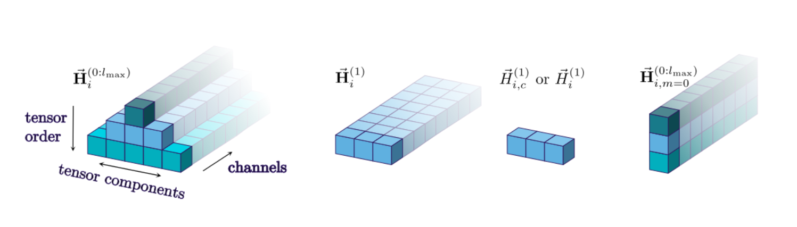

# LAMMPS CHEMTRAIN DEPLOY



**This repo is built on top of this [LAMMPS fork](https://github.com/tummfm/lammps/tree/chemtrain-deploy)** from [ChemTrain repo](https://github.com/tummfm/chemtrain) developers.

**LAMMPS** stands for **L**arge-scale **A**tomic/**M**olecular **M**assively **P**arallel **S**imulator.

This is the **LAMMPS** software package with the chemtrain deploy package linked to the code.

The **MLIP models** from https://github.com/camml-lab/tensorial.git are supported by this **LAMMPS** version.


Copyright (2003) Sandia Corporation. Under the terms of Contract DE-AC04-94AL85000 with Sandia Corporation, the U.S. Government retains certain rights in this software. This software is distributed under the GNU General Public License.

**LAMMPS** is a classical molecular dynamics simulation code designed to run efficiently on parallel computers. It was developed at Sandia National Laboratories, a US Department of Energy facility, with funding from the DOE. It is an open-source code, distributed freely under the terms of the GNU Public License (GPL) version 2.

The code is maintained by the LAMMPS development team who can be emailed at developers@lammps.org.

The **LAMMPS** website at [www.lammps.org](https://www.lammps.org) has more information about the code and its uses.

## Distribution contents

The LAMMPS distribution includes the following files and directories:

| File / Directory | Description |
|---|---|
| `README.md` | this file |
| `LICENSE` | the GNU General Public License (GPLv2) |
| `CITATION.cff` | Citation information for LAMMPS in CFF format |
| `apptainer` | Build apptainer container with LAMMPS Chemtrain code |
| `bench` | benchmark inputs |
| `cmake` | CMake build files |
| `doc` | documentation |
| `examples` | example inputs for many LAMMPS commands |
| `lib` | additional provided or external libraries |
| `potentials` | interatomic potential files |
| `python` | Python module for LAMMPS |
| `src` | source files |
| `tools` | pre- and post-processing tools |
| `unittest` | test programs for use with CTest |
| `.github` | Git and GitHub related files and tools |
| `chemtrain` | Chemtrain Git submodule|
| `tensorial` | Tensorial Git submodule|
| `ressources` | Scientific documentation and schemes|

## Documentation

Point your browser at any of these links to get started:

- [LAMMPS manual](https://docs.lammps.org/Manual.html)
- [Hi-level introduction](https://docs.lammps.org/Intro.html)
- [How to build LAMMPS](https://docs.lammps.org/Build.html)
- [How to run LAMMPS](https://docs.lammps.org/Run_head.html)
- [Table of available commands](https://docs.lammps.org/Commands_all.html)
- [Short tutorials and HowTo discussions](https://docs.lammps.org/Howto.html)
- [How to interpret and debug errors](https://docs.lammps.org/Errors.html)
- [LAMMPS library interfaces](https://docs.lammps.org/Library.html)
- [How to modify and extend LAMMPS](https://docs.lammps.org/Modify.html)
- [LAMMPS developer info](https://docs.lammps.org/Developer.html)

You can also create these doc pages locally:

```bash
cd doc
make html                # creates HTML pages in doc/html
make pdf                 # creates Manual.pdf
```

## Installation Instructions

#### Python venv initialisation

First install all required Python packages in your Python venv:

```bash
./bash/setup_python_venv.bash <path_to_your_python_venv>
```


#### Chemtrain deploy connector compilation

The CPU connector is already stored next to the connector sources in `lammps-chemtrain/src/CHEMTRAIN-DEPLOY/lib`

As regards the GPU connector, because of its size, it must be built from sources.

Then manually copy the `lib` directory in `src/CHEMTRAIN-DEPLOY/` under the name `lib-cuda`

For the CPU connector output directory `lib` must be paste to `lammps-chemtrain/src/CHEMTRAIN-DEPLOY`

Do not forget to setup your CUDA version in if your are compiling the CUDA version in `bash/utils.bash`

To compile libconnector.so, use the following script :

```bash
./bash/setup_python_venv.bash <path_to_your_python_venv> <cpu/cuda>
```

If you don't have enough RAM to compile, you can limit the ressources used by Bazel (you'll have to modify the `setup_python_venv.bash` script)

```bash
python build.py \
# Compilation options
--bazel_options=--jobs=4 \
--bazel_options=--local_resources=cpu=4 \
--bazel_options=--local_resources=memory=HOST_RAM*.5
```

#### LAMMPS compilation

If your are compiling for a GPU target, do not forget to set the `CHEMTRAIN_DEPLOY_LIBCONNECTOR` variable in your CMake preset.

```bash
source <path_to_your_venv>/bin/activate
cd lammps-chemtrain
rm -rf build
mkdir build
cd build
cmake ../cmake --preset=chemtrain # For CPU
cmake ../cmake --preset=chemtrain-cuda-hopper # For Nvidia Hopper based GPU
make -j $(nproc --all)
```

## Build Apptainer Containers

To build Apptainer containers, you can use the provided bash scripts.

Please note that for the **CUDA** container, you'll need to modify the script `bash/utils.bash` to match your cluster packages installation.

```bash
#Build the containers
./bash/setup_apptainer.bash cpu #For the CPU version
./bash/setup_apptainer.bash cuda #For the CUDA version

#Run The containers
# Run LAMMPS (CPU)
apptainer run lammps-chemtrain.sif lmp in.chemtrain-deploy-bulk-tensorial
# Run LAMMPS (CUDA)
export NP=<number_of_GPU> && apptainer run --nv lammps-chemtrain.sif lmp in.chemtrain-deploy-bulk-tensorial-gpu
# Export model checkpoint to a ptb file which can be read by LAMMPS
apptainer run lammps-chemtrain.sif export -c config.yaml -ck last.cpkt
```

## Tests

To test the export-model script, run the following command :

```bash
source <path_to_your_venv>/bin/activate
cd lammps-chemtrain
pytest python/model-export/tests/test_export_model.py -v
```

## Git Hooks

To enable custom Git hooks, run the following command:

```bash
./bash/setup_hooks.bash
```
